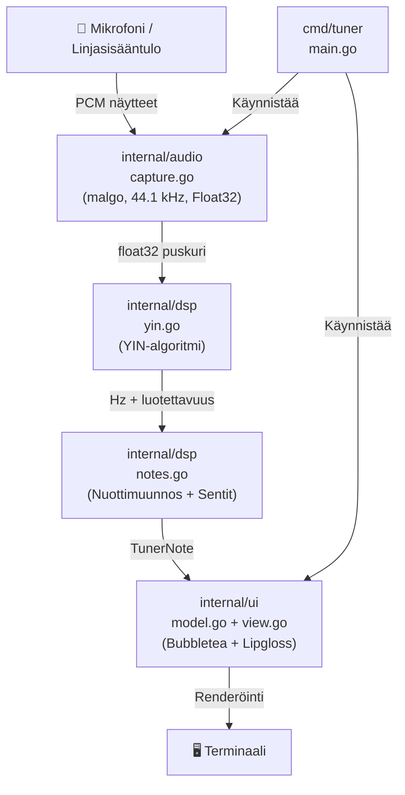

# Projektilokit — Kitaranviritin

Tämä tiedosto on projektin elävä lokikirja. Jokainen merkittävä sessio, päätös, muutos tai virstanpylväs kirjataan tähän kronologisessa järjestyksessä.

**Formaatti:** `## [YYYY-MM-DD] Sessio N — Lyhyt kuvaus`

---

## Sisällysluettelo

- [Projektin tila (aina ajantasainen)](#projektin-tila)
- [Arkkitehtuurikartta](#arkkitehtuurikartta)
- [Kehitysvaiheet](#kehitysvaiheet)
- [Sessiolokit](#sessiolokit)

---

## Projektin tila

> **Päivitetty viimeksi:** 2026-10-15

| Osa | Tiedosto/Paketti | Tila | Huomiot |
| --- | --- | --- | --- |
| Projekti-infrastruktuuri | `Taskfile.yml`, `go.mod`, `.github/ci.yml` | ✅ Valmis | CI ajaa lint + test |
| DSP: Nuottilaskenta | `internal/dsp/notes.go` | ✅ Valmis | `FrequencyToNote` + `ClosestGuitarString` toteutettu ja testattu |
| DSP: Testit | `internal/dsp/notes_test.go` | ✅ Valmis | Kaikki testit vihreä (NaN-vertailu korjattu) |
| DSP: YIN-algoritmi | `internal/dsp/yin.go` | ❌ Ei aloitettu | Vaihe 2b suunnitelmassa |
| Audio capture | `internal/audio/capture.go` | ❌ Ei aloitettu | malgo-riippuvuus lisäämättä |
| TUI | `internal/ui/model.go`, `view.go` | ❌ Ei aloitettu | Bubbletea + Lipgloss |
| Pääohjelma | `cmd/tuner/main.go` | ❌ Ei aloitettu | Integrointi vaiheessa 5 |
| PR tarinat | `pr_stories/` | ❌ Tyhjä | Ensimmäinen PR tulossa dsp-vaiheesta |

**Versio:** 0.1.0
**Aktiivinen haara:** `feat/dsp-note-converter`

---

## Arkkitehtuurikartta

---

## Kehitysvaiheet

| Vaihe | Kuvaus | Tila |
| --- | --- | --- |
| **Vaihe 0** | Projekti-infrastruktuuri (Taskfile, CI, AGENTS, plans) | ✅ Valmis |
| **Vaihe 1** | DSP: Nuottilaskenta (`notes.go` + `notes_test.go`) | 🔧 Kesken |
| **Vaihe 2** | DSP: YIN-algoritmi (`yin.go` + `yin_test.go`) | ❌ Edessä |
| **Vaihe 3** | Äänen kaappaus (`internal/audio/capture.go`) | ❌ Edessä |
| **Vaihe 4** | TUI (`internal/ui/model.go` + `view.go`) | ❌ Edessä |
| **Vaihe 5** | Integrointi ja kokonaisajotesti | ❌ Edessä |

---

## Sessiolokit

---

### 2026-10-15 — Sessio 2: DSP Vaihe 1 — Nuottilaskenta valmis

**Tehtävä:** Korjata `internal/dsp/notes.go` ja `internal/dsp/notes_test.go` bugit, lisätä puuttuvat `FrequencyToNote` ja `ClosestGuitarString` funktiot, saada testit vihreäksi.

**Mitä tehtiin:**

- Korjattu `CentsDeviatrion` typo → `CentsDeviation`
- Korjattu `math.isNaN` → `math.IsNaN` (Go:n oikea funktio)
- Lisätty täydellinen `CentsDeviation` funktio (apufunktio senttilaskentaan)
- Lisätty `ClosestGuitarString` funktio (kitaran kielien tunnistus taajuuksien perusteella)
- Lisätty pääfunktio `FrequencyToNote` (keskeisin: muuntaa taajuuden TunerNote-rakenteeksi)
- Korjattu `notes_test.go` syntaksivirhe rivillä ~71
- Korjattu `notes_test.go` NaN-vertailu edge-case (NaN ≠ NaN Go:ssa, vaatii `math.IsNaN` tarkistus)

**Löydökset ja ongelmat:**

- ✅ Ei ongelmia — kaikki testit menevät läpi
- `task check` (tidy + lint + test) tuottaa vihreät tulokset

**Päätökset:**

- Nuottilaskenta on nyt täysin testattu ja toimintakykyinen
- Seuraava vaihe: `internal/dsp/yin.go` — YIN-algoritmi sävelkorkeuden tunnistukseen

**Seuraava askel:**

- Suunnitella ja implementoida YIN-algoritmi (synteettisillä testeillä)
- Luoda `.plans/03-yin-pitch-detector.md` opetusdokumentti

**Versio:** 0.1.0 (ei bumppia, vain bugikorjausta)

---

**Tehtävä:** Projektin kokonaistilanteen kartoitus ja dokumentaatioinfrastruktuurin luominen.

**Mitä tehtiin:**

- Luettiin koko projektin rakenne: `AGENTS.md`, suunnitelmat, kooditiedostot, `Taskfile.yml`, CI-konfiguraatio, git-historia
- Identifioitiin projektin tila (ks. taulukko yllä)
- Luotiin tämä lokijärjestelmä (`PROJECTLOG.md`)
- Luotiin Kiro-steering-tiedosto (`.kiro/steering/project-context.md`) automaattiseen kontekstin lataukseen

**Löydökset ja ongelmat:**

- `internal/dsp/notes.go`: Funktio `CentsDeviation` on kirjoitettu `CentsDeviatrion` (kirjoitusvirhe) ja käyttää `math.isNaN` (pitää olla `math.IsNaN`)
- `internal/dsp/notes_test.go`: Syntaksivirhe rivillä ~71: `DefaultInTuneTolerance+` — lauseke kesken, sulkeva `}` puuttuu
- `FrequencyToNote` ja `ClosestGuitarString` -funktiot puuttuvat `notes.go`:sta kokonaan — vain rakenteet ja vakiot määritelty
- Kaikki paketit `internal/audio`, `internal/ui` ja `cmd/tuner` puuttuvat — projekti ei käänny vielä

**Päätökset:**

- Lokitusjärjestelmä rakennetaan tähän tiedostoon + Kiro steering + session-start hook
- Seuraava sessio: korjataan `notes.go` + `notes_test.go` bugit, lisätään puuttuvat funktiot → `go test ./...` vihreäksi

**Versio:** 0.1.0 (ei bumppia, vain infraa)

---

### 2026-10-15 — Sessio 3: Workflow-järjestelmän rakentaminen

**Tehtävä:** Luoda täydellinen, standardoitu kehitysworkflow suunnitelmasta PR-storien loppuun, kaikki konventioita noudattaen. Tavoite: kehittäjä voi seurata yksinkertaisia vaiheita ja tuottaa laadukkaan, hyvin dokumentoidun koodin ja PR:n.

**Mitä tehtiin:**

- Luotu `.plans/WORKFLOW.md` — 5-vaiheen workflow: Suunnitelma → Haara → Toteutus → Commitointi → PR
- Luotu `.plans/QUICK_START.md` — nopea 5-minuuttinen opas kehittäjille
- Luotu 3 PR-story-templatea:
  - `PR_STORY_COMPACT.template.md` — bugfixet, pienet featuret (~500–800 sana)
  - `PR_STORY_EXTENDED.template.md` — suuret featuret, multi-layer (~1500–3000 sana)
  - `PR_STORY_VISUAL.template.md` — diagrammipainotteiset PRt (~800–1500 sana)
- Lisätty workflow-apurit Taskfileen: `task workflow`, `task pr:template`
- Päivitetty `.kiro/steering/project-context.md` koko workflow-kontekstilla
- Luotu `.plans/INDEX.md` — navigointi kaikkiin dokumentaatioihin

**Löydökset ja ongelmat:**

- ✅ Ei ongelmia — workflow-järjestelmä on kattava ja toimiva
- ✅ Kaikki templatet ovat esimerkkien kanssa selkeitä
- ✅ Taskfile-komennot automatisoi rutiinitoimenpiteet

**Päätökset:**

- Workflow-järjestelmä on nyt tuotantokäyttöön valmis
- Seuraava kehittäjäsessio voi käyttää suoraan `task workflow` ja `.plans/QUICK_START.md`:ä
- PR-story-valinta perustuu muutoksen kokoon ja tyypiin (COMPACT/EXTENDED/VISUAL)
- Jokainen feature aloitetaan suunnitelmasta (`.plans/XX-...-nimi.md`)

**Seuraava askel:**

- Käyttää workflow-järjestelmää YIN-algoritmin implementoinnissa (Vaihe 2)
- Kirjoittaa `.plans/03-yin-pitch-detector.md` opetusdokumentti
- Luoda haara: `feat/yin-pitch-detector`
- Seuraava PR käytöllä: EXTENDED template (YIN on suuri feature)

**Versio:** 0.1.0 (ei bumppia, vain infraa)

---

