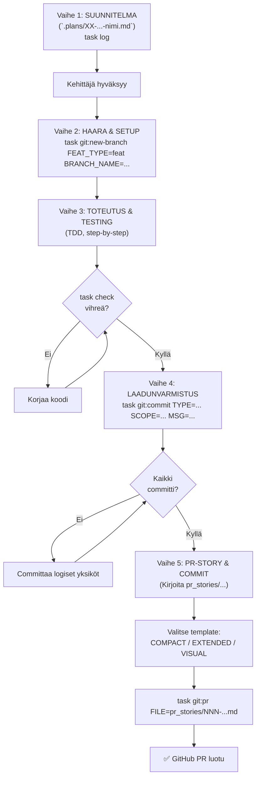

# Guitar Tuner — Kehitysworkflow

Tämä dokumentti määrittää standardoidun prosessin jokaisen kehitysvaiheen läpiviemiseksi: suunnitelmasta PR-storien loppuun.

## Yhteenveto: 5 vaihe

```
Vaihe 1: SUUNNITELMA
  ↓
Vaihe 2: HAARA & SETUP
  ↓
Vaihe 3: TOTEUTUS & TESTING
  ↓
Vaihe 4: LAADUNVARMISTUS
  ↓
Vaihe 5: PR-STORY & COMMIT
```

---

## Vaihe 1: SUUNNITELMA

**Milloin:** Jokaisen uuden kehitysvaieen alussa.

**Mitä:** Kirjoitetaan tai päivitetään suunnitelma-dokumentti `.plans/`-kansioon.

**Dokumentti-pohja:** `.plans/templates/PLAN_TEMPLATE.md`

**Sisältö:**
- Tavoite (nykytila → tavoitetila)
- Arkkitehtuurikaaviot (Mermaid)
- Tietokantamuutokset (jos tarvii)
- Backend-toteutus (Go)
- Frontend-toteutus (React)
- Testaussuunnitelma
- Vaiheittainen toteutusopas (step-by-step)

**Hyväksyminen:** Kehittäjä lukee suunnitelman ja hyväksyy ennen etenemistä.

**Komento:**
```bash
task log  # Avaa lokikirjan, lisää uuden suunnitelman viite
```

---

## Vaihe 2: HAARA & SETUP

**Milloin:** Kun suunnitelma on hyväksytty.

**Mitä:** Luodaan uusi git-haara ja alustetaan projekti.

**Haaran nimeäminen:**
- Muoto: `<type>/<kebab-case-description>`
- Esimerkit: `feat/yin-pitch-detector`, `fix/nan-comparison-bug`, `docs/dsp-theory`

**Komennot:**

1. **Luo uusi haara:**
   ```bash
   task git:new-branch FEAT_TYPE=feat BRANCH_NAME=yin-pitch-detector
   ```

2. **Varmista että olet oikeassa haarassa:**
   ```bash
   git branch --show-current
   ```

3. **Päivitä lokikirja:**
   ```bash
   task log  # Lisää merkintä: "Vaihe 2 — Haara <type>/<name> luotu"
   ```

---

## Vaihe 3: TOTEUTUS & TESTING

**Milloin:** Kun haara on luotu.

**Mitä:** Kirjoitetaan koodi suunnitelman ohjeiden mukaan.

**Prosessi:**

1. **Kirjoita koodi suunnitelman step-by-step -ohjeiden mukaan**
   - Yksi vaihe kerrallaan
   - TDD-malli: testit ensin, sitten toteutus
   - Testaa jokaisen vaihe yksikkötesteillä

2. **Aja laadunvarmistus säännöllisesti:**
   ```bash
   task check  # Ajaa: tidy, lint, test
   ```

3. **Committaa logiset yksiköt:**
   - EI suuri "everything done" -commit
   - Pienempiä, merkityksellisiä committeja
   - Katso Vaihe 4 committin tekemisestä

---

## Vaihe 4: LAADUNVARMISTUS

**Milloin:** Jokaisen logiikan yksiköiden jälkeen ja ennen PR:n tekemistä.

**Mitä:** Laadunvarmistus ja hyväksi todetut git-komennot.

### 4.1 Koodi-laadun tarkistus

```bash
task check
# Tulostaa:
# ✓ go mod tidy
# ✓ go mod verify
# ✓ go vet ./...
# ✓ golangci-lint run ./... (jos asennettu)
# ✓ go test -v ./...
```

Kaikki tulee olla vihreä. Jos punaista:
1. Lue virheviesti huolella
2. Korjaa koodi
3. Aja uudelleen `task check`
4. Vasta sitten commitoi

### 4.2 Kohdallinen Commitointi

**Komento (mallissa):**
```bash
task git:commit TYPE=feat SCOPE=dsp MSG="implement frequency-to-note conversion" FILES="internal/dsp/notes.go internal/dsp/notes_test.go"
```

**TYPE-arvot (Conventional Commits):**
- `feat` — uusi ominaisuus
- `fix` — bugfix
- `test` — testien lisäys/parantaminen
- `refactor` — koodi-uudelleenjärjestely (ei toiminnallisuuden muutosta)
- `docs` — dokumentaation päivitys
- `perf` — suorituskyvyn parannus
- `ci` — CI/CD konfiguraation muutos
- `chore` — muut (esim. riippuvuuksien päivitys)

**SCOPE:** Mikä osa projektia (esim. `dsp`, `audio`, `ui`, `build`)

**MSG:** Lyhyt imperatiivi (esim. "implement", "fix", "add")

**FILES:** Mitä tiedostoja sisältyy (välilyönnillä erotettuna)

**Esimerkki:**
```bash
task git:commit TYPE=test SCOPE=dsp MSG="add edge-case tests for frequency-to-note" FILES="internal/dsp/notes_test.go"
```

**Tuloksena:**
```
test(dsp): add edge-case tests for frequency-to-note
```

### 4.3 Git Status -tarkistus

```bash
git status
# Varmista että:
# - Aktiivinen haara on oikea (feat/yin-pitch-detector)
# - Kaikki muutokset on commitoitu
# - Ei uncommitted changes
```

---

## Vaihe 5: PR-STORY & COMMIT (GitHub PR)

**Milloin:** Kun toteutus on valmis ja kaikki testit menevät läpi.

**Mitä:** Kirjoitetaan PR-story ja luodaan GitHub PR.

### 5.1 PR-Story Kirjoitus

**Sijainti:** `pr_stories/[NNN]-[type]-[kebab-case].md`

**Numerointi:** Sekventiaalinen; katso olemassa olevia: `pr_stories/001-...`, `pr_stories/002-...`

**Templatet:**

Valitse yksi kolmesta:

1. **COMPACT** — Pienet bugfixet, yksittäiset muutokset
   - Tiedosto: `.plans/templates/PR_STORY_COMPACT.template.md`
   - Pituus: ~500–800 sanaa
   - Rakenne: Yhteenveto, muutos, tarkistukset

2. **EXTENDED** — Suuret ominaisuudet, multi-layer arkkitehtuuri
   - Tiedosto: `.plans/templates/PR_STORY_EXTENDED.template.md`
   - Pituus: ~1500–3000 sanaa
   - Rakenne: Johdanto, visio, arkkitehtuuri, diagrammit, tiedostotaulukko, tarkistukset

3. **VISUAL** — Paljon diagrammeja ja visualisointeja
   - Tiedosto: `.plans/templates/PR_STORY_VISUAL.template.md`
   - Pituus: ~800–1500 sanaa
   - Rakenne: Kuvaus, Mermaid/SVG-kaaviot, dataflow, muutokset, tarkistukset

**Valinnan kriteeri:**

| Kriteeri | COMPACT | EXTENDED | VISUAL |
| --- | --- | --- | --- |
| Rivikoodien muutos | < 500 | > 500 | > 300 (diagrammeja) |
| Tiedostot muuttuneet | 1–3 | > 3 | > 3 + kaaviot |
| Kerroksia vaikutunut | 1–2 | > 2 | > 2 |
| Arkkitehtuuri-muutos | Ei | Kyllä | Kyllä |
| Diagrammien tarve | 0–1 | 1–3 | 3–5 |

**Esimerkki EXTENDED (DSP YIN-algoritmi):**

```markdown
# DSP: Implement YIN Pitch Detection Algorithm

> PR-story: `001-feat-dsp-yin-pitch-detector.md`

## Summary

Added complete YIN (Alain de Cheveigné & Hideki Kawahara, 2002) pitch detection 
implementation to `internal/dsp/yin.go`. This enables accurate fundamental frequency 
estimation even in polyphonic audio, avoiding octave errors common with FFT-only 
approaches on low-frequency guitar strings (E2 ≈ 82.4 Hz).

## Architecture

[Mermaid-kaaviot YIN:in sisäisestä algoritmista]

## Files Changed

| File | Lines Added | Type | Rationale |
| --- | --- | --- | --- |
| `internal/dsp/yin.go` | 450 | Feature | YIN algorithm implementation (4 phases) |
| `internal/dsp/yin_test.go` | 600 | Test | Synthetic sine wave tests, harmonics |
| `.plans/03-yin-pitch-detector.md` | 200 | Doc | Algorithm walkthrough & math |

## Checklist

- [x] All unit tests pass (synthetic sine waves 50 Hz – 500 Hz)
- [x] `task check` passes (go vet, go test, lint)
- [x] Coverage > 95% for `internal/dsp`
- [x] No panics on edge cases (NaN, Inf, zero frequency)
- [x] Latency < 10ms per frame (4096 samples @ 44.1 kHz)

---
```

### 5.2 PR:n Luominen

**Komento:**
```bash
task git:pr FILE=pr_stories/001-feat-dsp-yin-pitch-detector.md
```

**Mitä komento tekee:**
1. ✅ Aja `task check` (viimeinen laadunvarmistus)
2. ✅ Pushaa haara `origin`:iin
3. ✅ Luo GitHub PR automaattisesti
4. ✅ Käyttää PR-story-tiedoston sisältöä PR:n body-tekstinä
5. ✅ Asettaa PR:n otsikoksi ensimmäisen rivin (tulee sijainnista `.plans/templates/PR_STORY_EXTENDED.template.md` — `# ...` korkein tason heading)

**Vaihtoehtoinen: PR:n luominen manuaalisesti (jos automation failaa):**
```bash
git push origin feat/yin-pitch-detector
gh pr create --title "feat(dsp): implement yin pitch detection algorithm" \
  --body-file pr_stories/001-feat-dsp-yin-pitch-detector.md
```

### 5.3 PR Body:n Päivitys (myöhemmin)

Jos kirjoitit PR:n mutta haluat päivittää bodyn myöhemmin:

```bash
task git:pr-body FILE=pr_stories/001-feat-dsp-yin-pitch-detector.md PR=1
```

---

## Workflow — Kaavio



---

## Task-komennot yhteenveto

```bash
# Vaihe 1: Dokumentointi
task log                  # Avaa lokikirja editorissa

# Vaihe 2: Haaran luominen
task git:new-branch FEAT_TYPE=feat BRANCH_NAME=feature-name

# Vaihe 3: Toteutus & testaus
task check                # Aja: tidy, lint, test (kaikki portit)
go test -v ./...          # Yksinkertainen test-ajo

# Vaihe 4: Commitointi
task git:commit TYPE=feat SCOPE=dsp MSG="short message" FILES="file1.go file2.go"

# Vaihe 5: PR
task git:pr FILE=pr_stories/001-type-name.md

# Git-apurit
git status                # Näytä status
git diff main...HEAD      # Näytä erot päähaara vastaan
task log:status           # Projektin tila-yhteenveto
```

---

## Esimerkki: Täydellinen workflow YIN-algoritmin implementoinnille

### Askel 1: Lue suunnitelma
```bash
# Avaa .plans/03-yin-pitch-detector.md
# Ymmärrä: YIN:in 4 vaihe, testaus synteettisillä signaaleilla, math
```

### Askel 2: Luo haara
```bash
task git:new-branch FEAT_TYPE=feat BRANCH_NAME=yin-pitch-detector
# ✓ Haara: feat/yin-pitch-detector
```

### Askel 3: Toteuta vaihe kerrallaan
```bash
# Vaihe 1: Difference function
# - Kirjoita test (internal/dsp/yin_test.go)
# - Kirjoita koodi (internal/dsp/yin.go)
# - Testaa: task check

task git:commit TYPE=feat SCOPE=dsp MSG="add yin difference function" FILES="internal/dsp/yin.go internal/dsp/yin_test.go"

# Vaihe 2: Cumulative mean normalization
task git:commit TYPE=feat SCOPE=dsp MSG="add yin cumulative mean normalization" FILES="internal/dsp/yin.go internal/dsp/yin_test.go"

# ... jne
```

### Askel 4: Laadunvarmistus
```bash
task check  # Kaikki vihreä?
```

### Askel 5: Kirjoita PR-story
```bash
# Valitse template (EXTENDED sopii):
cp .plans/templates/PR_STORY_EXTENDED.template.md pr_stories/001-feat-dsp-yin-pitch-detector.md

# Täytä pohja:
# - Yhteenveto (YIN-algoritmi, miksi tarvitaan)
# - Arkkitehtuuri (kaavio YIN:in 4 vaiheesta)
# - Tiedostomuutokset
# - Tarkistuslistat (testit, linter, coverage)
```

### Askel 6: Luo PR
```bash
task git:pr FILE=pr_stories/001-feat-dsp-yin-pitch-detector.md
# ✓ PR luotu GitHub:issa
# ✓ PR:n body sisältää tiedot pr_stories-tiedostosta
```

---

## Parhaita käytäntöjä

1. **Committaa usein** — Jokainen logiikka yksikkö = yksi commit
2. **Testaa koko ajan** — `task check` ennen jokaista commitia
3. **Kirjoita hyvät commit-viestit** — Conventional Commits auttaa historiaa
4. **PR-story on tärkeä** — Se on PR:n sydän; vie aikaa sen kirjoittamiseen
5. **Päivitä lokikirja** — `task log` jokaisen session lopussa
6. **Vältä suuria haaroja** — Max 500–1000 rivin PR:t ovat parempia kuin 5000+ riviä

---

