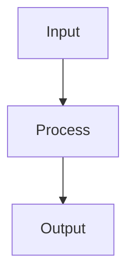
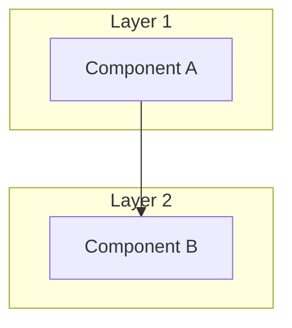

# [Type(Scope)]: [Feature Title with Visual Focus]

> **File:** `pr_stories/[NNN]-[type]-[kebab-case-name].md`
>
> **Use this template for:** Data pipelines, UI flows, architectural refactors
>
> **Target length:** 800–1500 words  
> **Diagrams:** 3–5 (Mermaid, ASCII art)

---

## Overview

One sentence summary of what this PR does visually.

---

## Data Flow Visualization

### Before

```
[Source] ─→ [Dead End]
```

### After

```
[Source] ─→ [Step 1] ─→ [Step 2] ─→ [Result]
```

---

## Architecture Diagram



---

## Component Interaction



---

## Test Coverage Matrix

| Module | Coverage | Status |
|--------|----------|--------|
| Module A | 95% | ✅ Complete |
| Module B | 85% | 🟡 Partial |

---

## Files Changed

| File | Type | Purpose |
|------|------|---------|
| file1.go | Feature | Main implementation |
| file2_test.go | Test | Test suite |

---

## Quality Checklist

- [x] `task check` passes
- [x] All tests passing
- [x] Coverage > 90%

---

