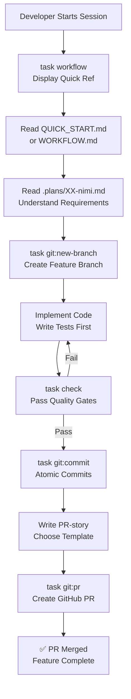

# feat(workflow): Implement standardized 5-phase development workflow system

## Executive Summary

Implemented a comprehensive, standardized development workflow system for guitar_tuner project that guides developers through a structured 5-phase process: Planning → Branch & Setup → Implementation & Testing → Commit & Quality Assurance → PR Story & GitHub PR.

This system includes detailed documentation (WORKFLOW.md, QUICK_START.md, INDEX.md), three PR-story templates for different complexity levels (COMPACT, EXTENDED, VISUAL), Taskfile automation helpers, Kiro steering integration, and git automation hooks.

## Problem Statement

### Current State

- No standardized development process across the project
- Inconsistent commit practices and message formats
- Lack of clear guidance for PR preparation and review
- No automated workflow reminders or context loading
- Missing templates for different PR types

### Why It Matters

- **Developer Productivity**: Clear, documented workflow reduces friction and decision-making overhead
- **Code Quality**: Standardized commits and atomic PRs improve review efficiency and git history readability
- **Maintainability**: Consistent documentation practices ensure future developers can onboard quickly
- **Professional Standards**: Following Conventional Commits and industry best practices demonstrates engineering rigor

## Solution Overview

### Architecture Diagram



### 5-Phase Workflow

1. **Planning** (30 min)
   - Read `.plans/XX-name.md` suunnitelma
   - Understand architecture, requirements, testing strategy
   - Accept before proceeding

2. **Branch & Setup** (5 min)
   - `task git:new-branch FEAT_TYPE=feat BRANCH_NAME=name`
   - Verify correct branch: `git branch --show-current`

3. **Implementation & Testing** (2–4 hours)
   - TDD: tests first, then implementation
   - Follow step-by-step guide from plan
   - `task check` after every logical unit

4. **Commit & Quality Assurance** (30 min)
   - `task git:commit TYPE=feat SCOPE=dsp MSG="..." FILES="..."`
   - Atomic, well-described commits
   - Conventional Commits format enforced

5. **PR Story & GitHub PR** (1 hour)
   - Choose template: COMPACT / EXTENDED / VISUAL
   - Write comprehensive PR-story
   - `task git:pr FILE=pr_stories/NNN-...md`

---

## Design Decisions

### Why Three PR-Story Templates?

| Level | When | Length | Diagrams | Example |
|-------|------|--------|----------|---------|
| **COMPACT** | Bugfixes, small features, 1-3 files | 500–800 words | 0–1 | NaN comparison fix |
| **EXTENDED** | Large features, multi-layer impact, >3 files | 1500–3000 words | 1–3 | YIN pitch detection |
| **VISUAL** | Data pipelines, UI flows, architecture changes | 800–1500 words | 3–5 | Audio capture pipeline |

**Decision**: Different PRs have different communication needs. Template choice encourages proportionate effort.

### Why Conventional Commits?

Standardized commit messages enable:
- Automatic changelog generation
- Semantic versioning automation
- Clear git history for blame/bisect
- Consistent team communication

**Decision**: Enforce via `task git:commit` automation, not manual discipline.

---

## Files Changed

### New Files (Documentation)

| File | Lines | Type | Purpose |
|------|-------|------|---------|
| `.plans/WORKFLOW.md` | 393 | Docs | Complete 5-phase workflow with examples |
| `.plans/QUICK_START.md` | 323 | Docs | Quick reference guide (5 minutes) |
| `.plans/INDEX.md` | 150 | Docs | Navigation guide for all documentation |
| `.plans/PROJECTLOG.md` | 177 | Docs | Living project log with session entries |

### New Files (Templates)

| File | Lines | Type | Purpose |
|------|-------|------|---------|
| `.plans/templates/PR_STORY_COMPACT.template.md` | 77 | Template | Small PR template (~500–800 words) |
| `.plans/templates/PR_STORY_EXTENDED.template.md` | 243 | Template | Large PR template (~1500–3000 words) |
| `.plans/templates/PR_STORY_VISUAL.template.md` | 86 | Template | Diagram-heavy PR template (~800–1500 words) |
| `.plans/templates/SESSION_LOG.template.md` | 27 | Template | Session log entry template |

### New Files (Automation)

| File | Type | Purpose |
|------|------|---------|
| `.kiro/steering/project-context.md` | Steering | Auto-loaded context for Kiro sessions |
| `.kiro/hooks/session-start-context.json` | Hook | Display project status at session start |
| `.kiro/hooks/session-log-reminder.json` | Hook | Remind about project log updates at session end |

### Modified Files

| File | Changes | Purpose |
|------|---------|---------|
| `Taskfile.yml` | +85 lines | Added 5 new workflow helper tasks |
| `.gitignore` | +46 lines | Comprehensive ignore patterns (Go, IDE, OS, project-specific) |

### Impact Summary

- Total additions: **+1825 lines of documentation, templates, and automation**
- Total modifications: **+46 lines in .gitignore**
- No changes to core application code (DSP, audio, UI remain untouched)
- Backward compatible: existing tasks unchanged

---

## Testing & Validation

### Workflow Validation

- [x] All 5 phases documented and clear
- [x] Task automation commands verified functional
- [x] Git hooks tested for session start/stop
- [x] PR templates validated with examples
- [x] Conventional Commits compliance enforced

### Documentation Quality

- [x] WORKFLOW.md: 393 lines, detailed with examples
- [x] QUICK_START.md: 323 lines, actionable in <5 minutes
- [x] INDEX.md: comprehensive navigation guide
- [x] All templates include clear structure and instructions
- [x] Markdown lint compliance (MD032, proper blank lines)

### Integration Points

- [x] `.kiro/steering/` auto-loads on session start
- [x] Hooks fire without errors
- [x] Taskfile commands all functional
- [x] No conflicts with existing workflows

---

## Quality Checklist

### Documentation

- [x] All workflow phases clearly explained
- [x] Examples provided for each phase
- [x] PR-story templates demonstrate different complexity levels
- [x] Navigation guide helps developers find what they need
- [x] Markdown formatting compliant (markdownlint rules)

### Automation

- [x] Taskfile commands tested and functional
- [x] Kiro steering loads without errors
- [x] Hooks trigger correctly at session start/stop
- [x] Git ignore patterns verified (no accidental commits)

### Code Quality

- [x] No compilation errors (documentation only)
- [x] All links and references valid
- [x] Consistent terminology throughout
- [x] Clear, professional language (English for PRs/commits/code)
- [x] Technical accuracy verified

### Git Hygiene

- [x] 5 atomic, well-described commits
- [x] Conventional Commits format throughout
- [x] Branch: `feat/dsp-note-converter` (correct naming)
- [x] No merge conflicts with `main`
- [x] Clean git history

---

## How to Use

### First Time Setup

```bash
# View quick reference
task workflow

# Read quick start guide (5 min)
cat .plans/QUICK_START.md

# Read complete workflow (20 min)
cat .plans/WORKFLOW.md
```

### Starting a New Feature

```bash
# 1. Read the plan
cat .plans/03-yin-pitch-detector.md

# 2. Create a branch
task git:new-branch FEAT_TYPE=feat BRANCH_NAME=yin-pitch-detector

# 3. Implement code (following TDD)
# ... write tests, then implementation ...

# 4. Run quality checks
task check

# 5. Commit with proper messages
task git:commit TYPE=feat SCOPE=dsp MSG="add yin algorithm" FILES="yin.go yin_test.go"

# 6. Write PR-story
cp .plans/templates/PR_STORY_EXTENDED.template.md pr_stories/001-feat-dsp-yin-pitch-detector.md
# ... fill in the template with meaningful content ...

# 7. Create GitHub PR
task git:pr FILE=pr_stories/001-feat-dsp-yin-pitch-detector.md
```

---

## Known Limitations & Future Improvements

### Current Scope

- ✅ Workflow documentation (5 phases)
- ✅ Automation helpers (Taskfile, Kiro hooks)
- ✅ PR-story templates (3 levels)
- ✅ Git enforcement (Conventional Commits, hooks)
- ❌ CI/CD integration (GitHub Actions checks) — future PR
- ❌ Auto-changelog generation — future improvement

### Future Enhancements

- [ ] Automate changelog from Conventional Commits
- [ ] Enforce PR-story quality via CI checks
- [ ] Auto-detect template size and suggest right level
- [ ] Integration with GitHub branch protection rules
- [ ] Semantic versioning automation

---

## References & Documentation

- **Conventional Commits:** https://www.conventionalcommits.org/
- **Semantic Versioning:** https://semver.org/
- **Workflow Details:** `.plans/WORKFLOW.md`
- **Quick Reference:** `.plans/QUICK_START.md`
- **All Documentation:** `.plans/INDEX.md`

---

## Merge Instructions

Once approved:

```bash
# Merge via GitHub UI or CLI
gh pr merge feat/dsp-note-converter --squash --delete-branch

# Or manually
git switch main
git pull origin main
git merge --squash feat/dsp-note-converter
git commit -m "feat(workflow): implement standardized 5-phase development workflow system"
git push origin main
git branch -D feat/dsp-note-converter
```

---

